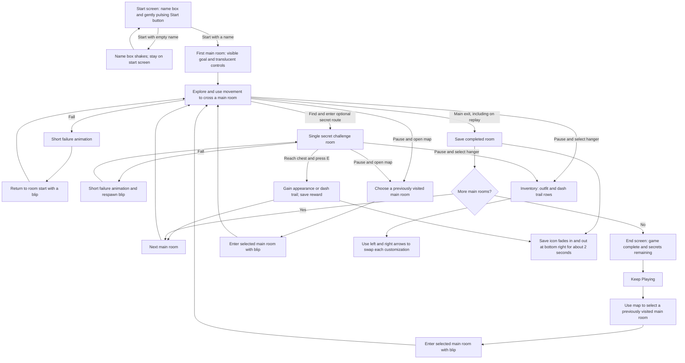

# Platformer flow plan

This is the player flow for the first version of the low gravity platformer. The implementation will make dash momentum taper off more smoothly while keeping the other movement behaviors the player liked.

## Player and first ten seconds

Design for a keyboard player who has a few minutes to try a movement challenge, enjoys improving through repeated attempts, and notices possible secrets. Use the preferences recorded in `~/codex/tastes.md`. The game does not address Quinn by name. It asks each player for their name at the start so future dialogue can use it.

The start screen has a name box and a gently color-pulsing Start button. Pressing Start with an empty name shakes the name box a little and keeps the player on the start screen. With a name entered, starting opens the first room, where translucent controls teach movement. A visible goal gives the player something to try immediately. The scene has a space theme, with possibly Moon-textured terrain and subtle, similarly colored dust moving in the background.

## Core loop and outcome

The first version has 15 main rooms plus six secret rooms. The player reads a room, tries a movement route, and reaches its exit. Main rooms get harder through wall jumps, carrying momentum after a dash, and timing wall slides. The fifth room should ask for a new combination or tighter execution than the first, making improvement visible without changing the basic controls. Each optional secret route takes extra skill and leads to one challenge room and a chest. Pressing E opens the chest for an appearance or dash trail. Completing the secret room advances to the next main room, so the detour does not trap the player.

After the final room, a screen states that the game is complete, shows how many of the six secret chests remain unopened, and offers Keep Playing. The player leaves the first run with a clear finish, the movement skill they built, and any appearance or dash trail rewards they discovered. The player can use a map to revisit previously visited main rooms, with a blip animation on arrival. Finishing a revisited room continues to the next main room; the map offers quick travel instead. Secret rooms are reached through their routes in the main rooms, not from the map.

The Pause menu also has an inventory button marked with a clothing hanger. Its two customization rows are stacked: outfit above dash trail. Each row has left and right arrows to cycle the available choices. There are no other customization categories in this version.

## Flowchart

## Navigation and persistence

- A Pause button appears at the top right. Its menu offers a map for quick travel to previously visited main rooms, a clothing-hanger inventory button, and a Settings button. Secret rooms are not travel destinations. Settings remains unimplemented for now.
- Browser Back returns to the main site for now.
- Progress is saved through Firestore for the same browser when a main room is completed or a secret chest is opened. Refresh resumes at the saved main room, with earned cosmetic rewards retained. Equipped outfit and dash trail should also be retained.
- The player name is for future dialogue. It is not an account or a way to recover progress on another browser or device.
- A successful save displays the save icon for about two seconds.

## Common edge cases

- First visit with no progress: show the name and Start screen, then begin at main room 1.
- Empty or whitespace-only name: shake the name box and stay on the start screen. An unrelated key or E away from a chest has no game effect.
- Fall: play a short failure animation, return to the current room start, and play the respawn blip. The player does not lose saved rooms or rewards.
- Refresh: restore the latest saved main room and rewards on the same browser. A refresh during an unfinished room restarts that room.
- Browser Back: return to the main site for now.
- Save failure: **proposed default for approval** — keep the player in the current session, show a small save error instead of the success icon, and offer retry. An unsaved change may be lost on refresh until retry succeeds.

## Final implementation choices

The exact art for the final screen, which main rooms hold the six secret routes, and the specific appearance or trail in each chest can be selected during implementation. They must follow the flow above.
